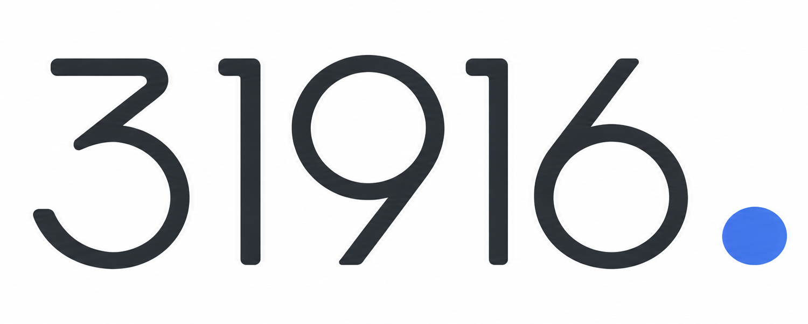
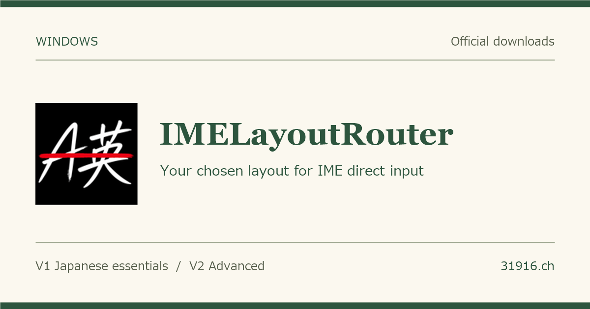
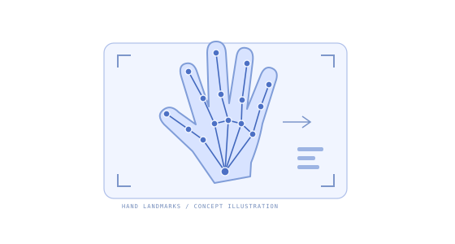
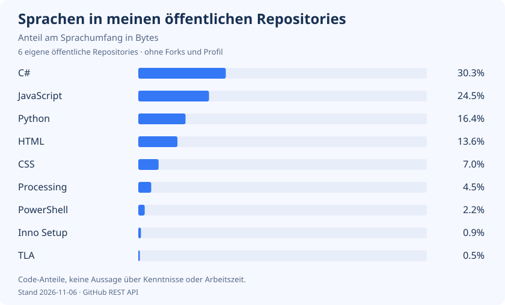
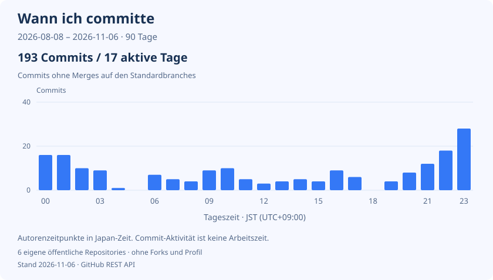

# Harry.

Haruto Kitagawa / 北川 温人

[English](README.md) · [日本語](README.ja.md) · **Deutsch**

[Portfolio](https://31916.ch/?lang=de) · [Lebenslauf](https://31916.ch/resume/?lang=de) · [Kontakt](https://31916.ch/?lang=de#contact)

## Projekte

<table>
  <tr>
    <td width="50%" align="center">
      
      
<a href="https://31916.ch/IMELayoutRouter/en.html"><strong>IMELayoutRouter</strong></a>

    </td>
    <td width="50%" align="center">
      
      
<a href="https://github.com/31916/syukei_recognize"><strong>Handformerkennung für Japanische Gebärdensprache</strong></a>

    </td>
  </tr>
  <tr>
    <td width="50%" align="center">
      
      
<a href="https://31916.ch/himoparty/"><strong>Himohodoki</strong></a>

    </td>
    <td width="50%" align="center">
      
      
<a href="https://31916.ch/IdeaDesigns/"><strong>Number Cursors 4</strong></a>

    </td>
  </tr>
</table>

## Technologien

**Programmiersprachen**

  &nbsp;C &nbsp;
  &nbsp;C# &nbsp;
  &nbsp;Java &nbsp;
  &nbsp;Python &nbsp;
  &nbsp;JavaScript

**Web**

  &nbsp;HTML &nbsp;
  &nbsp;CSS

**Numerische Berechnungen**

&nbsp;MATLAB

**Automatisierung**

&nbsp;Google Apps Script

**Entwicklungswerkzeuge & Umgebungen**

  &nbsp;Git &nbsp;
  &nbsp;GitHub &nbsp;
  &nbsp;Linux

## GitHub-Aktivität

Die Sprachanteile basieren auf dem Codeumfang in Bytes in meinen öffentlichen Repositorys, ohne Forks und dieses Profil-Repository. Die Zeitverteilung zeigt meine Commits auf deren Standardbranches aus den letzten 90 Tagen, nach japanischer Zeit (UTC+9). Sie misst keine Arbeitsstunden.

Täglich automatisch aktualisiert. [Daten und Methodik](docs/analytics.md)
