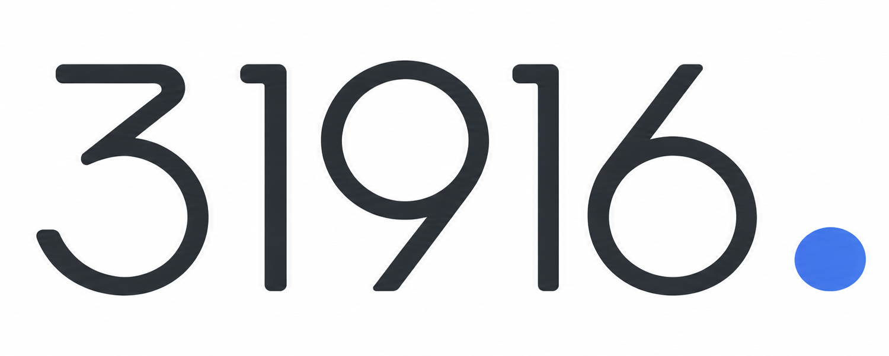
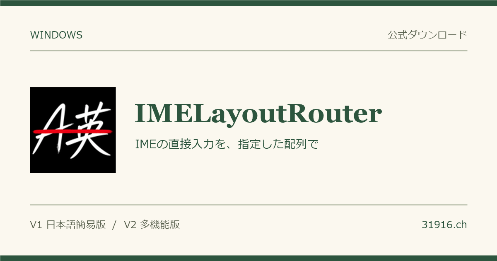
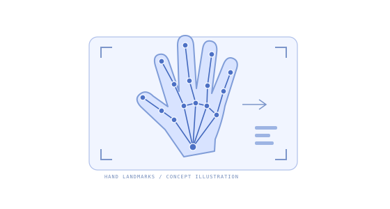
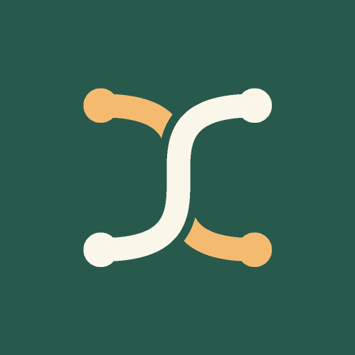
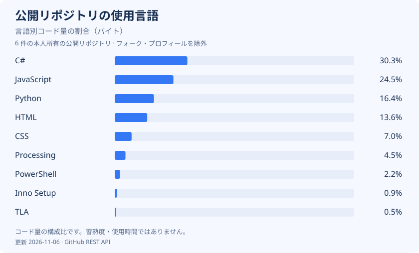
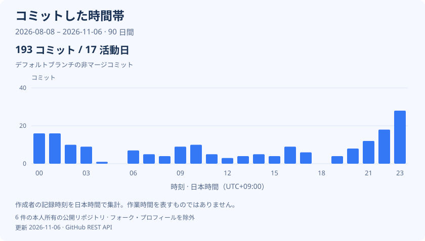

# Harry.

北川 温人 / Haruto Kitagawa

[English](README.md) · **日本語** · [Deutsch](README.de.md)

[ポートフォリオ](https://31916.ch/?lang=ja) · [履歴書](https://31916.ch/resume/?lang=ja) · [コンタクト](https://31916.ch/?lang=ja#contact)

## 制作物

<table>
  <tr>
    <td width="50%" align="center">
      
      
<a href="https://31916.ch/IMELayoutRouter/"><strong>IMELayoutRouter</strong></a>

    </td>
    <td width="50%" align="center">
      
      
<a href="https://github.com/31916/syukei_recognize"><strong>日本手話の手形認識</strong></a>

    </td>
  </tr>
  <tr>
    <td width="50%" align="center">
      
      
<a href="https://31916.ch/himoparty/"><strong>ひもほどき</strong></a>

    </td>
    <td width="50%" align="center">
      
      
<a href="https://31916.ch/IdeaDesigns/"><strong>Number Cursors 4</strong></a>

    </td>
  </tr>
</table>

## 技術スタック

**プログラミング言語**

  &nbsp;C &nbsp;
  &nbsp;C# &nbsp;
  &nbsp;Java &nbsp;
  &nbsp;Python &nbsp;
  &nbsp;JavaScript

**Web**

  &nbsp;HTML &nbsp;
  &nbsp;CSS

**数値計算**

&nbsp;MATLAB

**自動化**

&nbsp;Google Apps Script

**開発ツール・環境**

  &nbsp;Git &nbsp;
  &nbsp;GitHub &nbsp;
  &nbsp;Linux

## GitHubの活動

言語の割合は、自分の公開リポジトリにあるコードの容量（バイト数）から集計しています。フォークとこのプロフィール用リポジトリは除外しています。時間帯は、各リポジトリのデフォルトブランチにある、自分が作成した直近90日間のコミットを日本時間（UTC+9）で集計したものです。実際の作業時間を示すものではありません。

毎日自動更新。[データと集計方法](docs/analytics.md)
