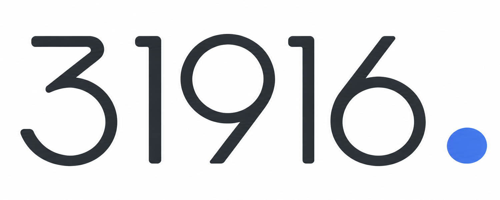
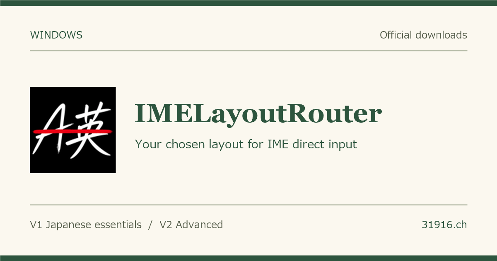
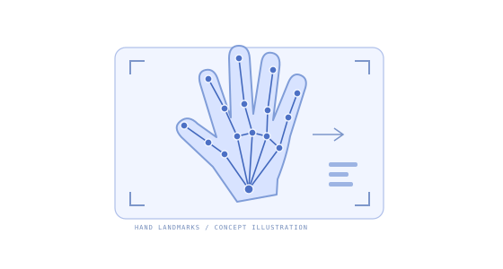
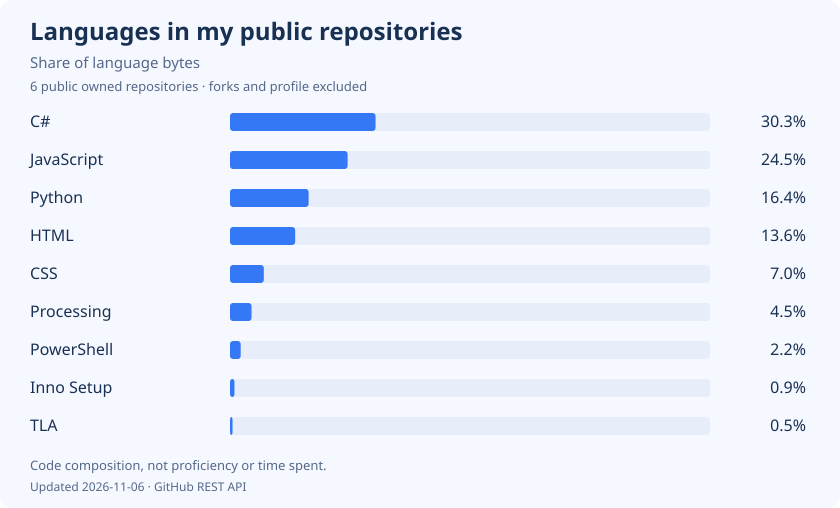
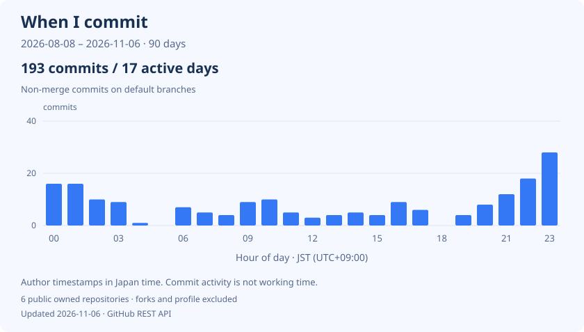

# Harry.

Haruto Kitagawa / 北川 温人

**English** · [日本語](README.ja.md) · [Deutsch](README.de.md)

[Portfolio](https://31916.ch/?lang=en) · [Resume](https://31916.ch/resume/?lang=en) · [Contact](https://31916.ch/?lang=en#contact)

## Projects

<table>
  <tr>
    <td width="50%" align="center">
      
      
<a href="https://31916.ch/IMELayoutRouter/en.html"><strong>IMELayoutRouter</strong></a>

    </td>
    <td width="50%" align="center">
      
      
<a href="https://github.com/31916/syukei_recognize"><strong>Japanese Sign Language handshape recognition</strong></a>

    </td>
  </tr>
  <tr>
    <td width="50%" align="center">
      
      
<a href="https://31916.ch/himoparty/"><strong>Himohodoki</strong></a>

    </td>
    <td width="50%" align="center">
      
      
<a href="https://31916.ch/IdeaDesigns/"><strong>Number Cursors 4</strong></a>

    </td>
  </tr>
</table>

## Tech stack

**Programming languages**

  &nbsp;C &nbsp;
  &nbsp;C# &nbsp;
  &nbsp;Java &nbsp;
  &nbsp;Python &nbsp;
  &nbsp;JavaScript

**Web**

  &nbsp;HTML &nbsp;
  &nbsp;CSS

**Numerical computing**

&nbsp;MATLAB

**Automation**

&nbsp;Google Apps Script

**Development tools & environments**

  &nbsp;Git &nbsp;
  &nbsp;GitHub &nbsp;
  &nbsp;Linux

## GitHub activity

Language shares use code bytes in my public repositories, excluding forks and this profile repository. Commit timing shows commits authored by me on their default branches over the last 90 days, in Japan Standard Time (UTC+9). It does not measure working hours.

Updated daily. [Data and methodology](docs/analytics.md)
